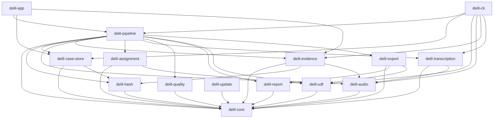
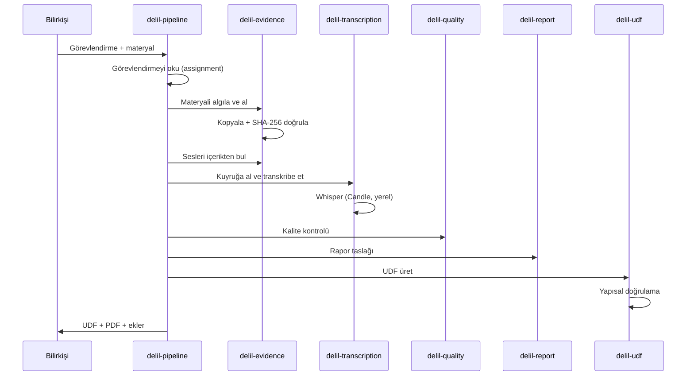
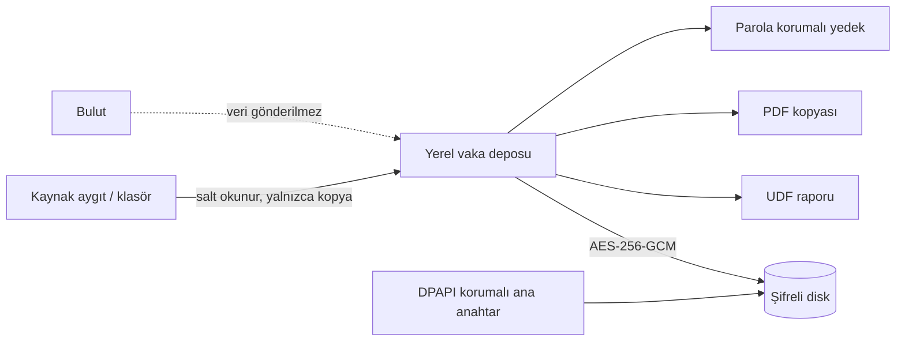

# DELİL — Teknik Mimari

## Genel bakış

DELİL, Rust ile yazılmış, Windows 11 x64 üzerinde çalışan yerel bir masaüstü
uygulamasıdır. Ana ve desteklenen platform Windows 11 x64'tür. Uygulama
tamamen çevrimdışıdır; bulut ASR, bulut OCR veya çevrimiçi yapay zekâ API'si
kullanılmaz.

## Teknoloji seçimleri

| Bileşen | Seçim | Gerekçe |
|---|---|---|
| Dil | Rust (edition 2021) | Bellek güvenliği, tek ikili, hız |
| Arayüz | egui / eframe 0.28 | Yerel, hafif, GPU hızlandırmalı |
| Transkripsiyon | Candle 0.8 + Whisper large-v3-turbo | Yerel, saf Rust çıkarım |
| Ses çözme | Yerleşik WAV PCM çözücü + Symphonia | Harici FFmpeg gerekmez |
| OCR | ocrs 0.14 + rten | Yerel, çevrimdışı |
| Veritabanı/meta | JSON + şifreli zarf | Basit, denetlenebilir |
| Şifreleme | AES-256-GCM + Argon2id + DPAPI | Doğrulanmış AEAD |
| UDF | zip + quick-xml | Gerçek UDF biçimi |
| PDF | printpdf + gömülü DejaVu | Türkçe karakter desteği |
| Güncelleme | ed25519-dalek + SHA-256 | İmzalı, doğrulanabilir |

**Kullanılmayan teknolojiler:** Electron, Tauri, Node.js, Python çalışma
zamanı, bulut ASR/OCR, kullanıcının kuracağı FFmpeg, kullanıcının indireceği
Whisper modeli, kullanıcının Cargo/Rust kurmasını gerektiren teslim.

## Crate bağımlılık grafiği

Modüller gereksiz bağımlılıktan uzak tutulur; `delil-core` yalnızca serde,
chrono, uuid ve thiserror kullanır.

## İş akışı (şartname 4.2)

## Güvenlik ve veri akışı

Hiçbir ses, transkript, görevlendirme, taraf bilgisi, dosya numarası, rapor
veya materyal manifesti bulut sistemine gönderilmez.

## UDF biçimi

UDF, Deflate sıkıştırmalı bir ZIP arşividir ve içinde `content.xml` barındırır.
Metin havuzu (CDATA) + karakter tabanlı ofsetler yaklaşımı kullanılır. Ayrıntı
için `AGENTS.md` ve `docs/UDF_UYUMLULUK.md`.

## İş parçacığı modeli

- Arayüz ana iş parçacığında çalışır (egui).
- İş akışı ayrı bir iş parçacığında yürütülür; ilerleme bir kanal (mpsc)
  üzerinden arayüze aktarılır.
- Transkripsiyon kuyruğu tek iş parçacığında sıralı çalışır; uzun işler
  duraklatma/iptal bayrağını düzenli aralıklarla kontrol eder.
- Kuyruk durumu JSON olarak diske yazılır; kesintiden devam eder.

## Performans ve bellek

- Hash hesaplama 1 MiB tamponla akış hâlinde yapılır; büyük dosyalarda bellek
  sabit kalır.
- Ses çözme 16 kHz mono f32'ye indirger; Whisper girişi budur.
- Uzun kayıtlar 30 saniyelik parçalara ayrılır; parça sınırında metin kaybı
  kalite kontrolünde ayrıca tespit edilir.

## Hata ve istisna yönetimi

Uygulama yalnızca gerçekten karar gerektiren durumlarda kullanıcıya sorar:
birden fazla harici aygıt, okunamayan dosya numarası, bozuk ses, desteklenmeyen
codec, çok düşük ses, anlaşılmayan bölüm, örtüşen konuşma, şüpheli model
çıktısı, dayanağı bulunamayan soru, doldurulmamış mesleki kanaat. İstisna
ekranı teknik hata kodları yığmaz; sorunu ve gereken kararı sade biçimde
açıklar.
